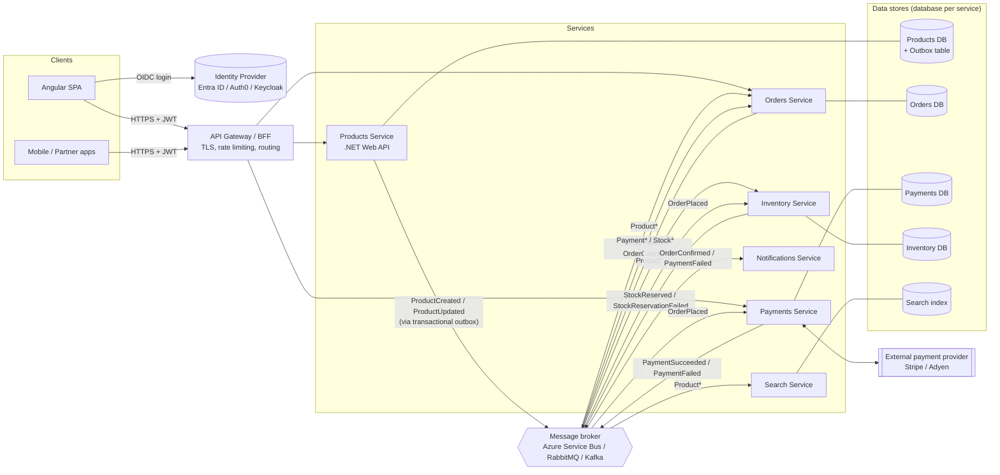
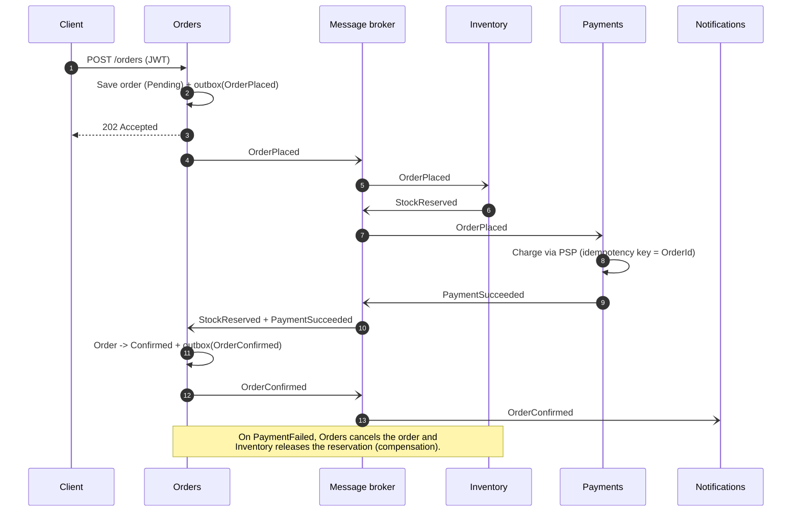
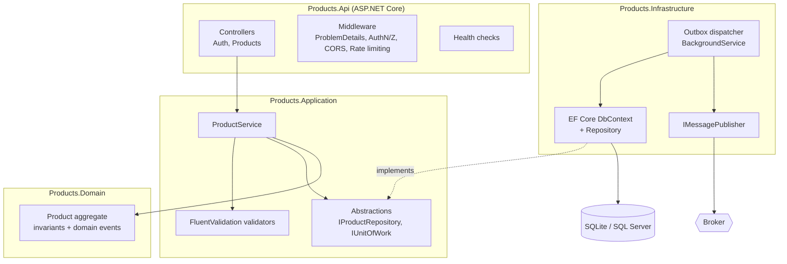

# Architecture

## 1. Products service in an event-driven microservices landscape

### How the pieces interact

| Component | Responsibility | Publishes | Subscribes to |
|---|---|---|---|
| **Products** (this repo) | Owns the product catalogue (source of truth for name, colour, price). | `ProductCreated` (and later `ProductUpdated`, `ProductDiscontinued`) | – |
| **Orders** | Order lifecycle; keeps a local read-model of products for pricing snapshots, so it never calls Products synchronously when placing an order. | `OrderPlaced`, `OrderConfirmed`, `OrderCancelled` | `Product*`, `Payment*`, `Stock*` |
| **Payments** | Takes payment through the external PSP and is idempotent on `OrderId`. | `PaymentSucceeded`, `PaymentFailed` | `OrderPlaced` |
| **Inventory** | Stock levels and reservations. | `StockReserved`, `StockReservationFailed` | `ProductCreated`, `OrderPlaced` |
| **Search** | Denormalised, searchable catalogue (e.g. filter by colour at scale). | – | `Product*` |
| **Notifications** | Email/SMS to customers. | – | `OrderConfirmed`, `PaymentFailed` |

### Example flow: placing an order (choreographed saga)

### Key design decisions

- **Database per service.** No service reads another service's database. Data is shared only through APIs and events.
- **Transactional outbox.** The Products service writes the `ProductCreated` event to an `OutboxMessages` table in the *same* transaction as the product. A background dispatcher then publishes it to the broker. This avoids the "dual write" problem, where the DB commit succeeds but the publish fails, and gives at-least-once delivery.
- **Idempotent consumers.** Events carry a unique `eventId` (UUIDv7). Consumers record the ids they have processed so that redelivered events have no further effect.
- **Choreography over orchestration** for simple flows. A process manager such as MassTransit sagas or Durable Functions can be introduced once flows become complex.
- **Security at the edge and in every service.** The gateway terminates TLS and applies coarse rate limiting. Each service still validates the JWT (issuer, audience, signature, lifetime) and enforces scope-based policies such as `products.read` and `products.write` (zero trust).
- **Observability.** Use OpenTelemetry traces, metrics and logs, propagating `traceparent` across HTTP and message headers. Every service exposes `/health/live` and `/health` for orchestrator liveness and readiness probes.

## 2. Internal structure of the Products service

Dependencies point inwards (Clean Architecture). The Domain has no dependencies. The Application layer depends only on the Domain. Infrastructure and Api sit on the outside.
